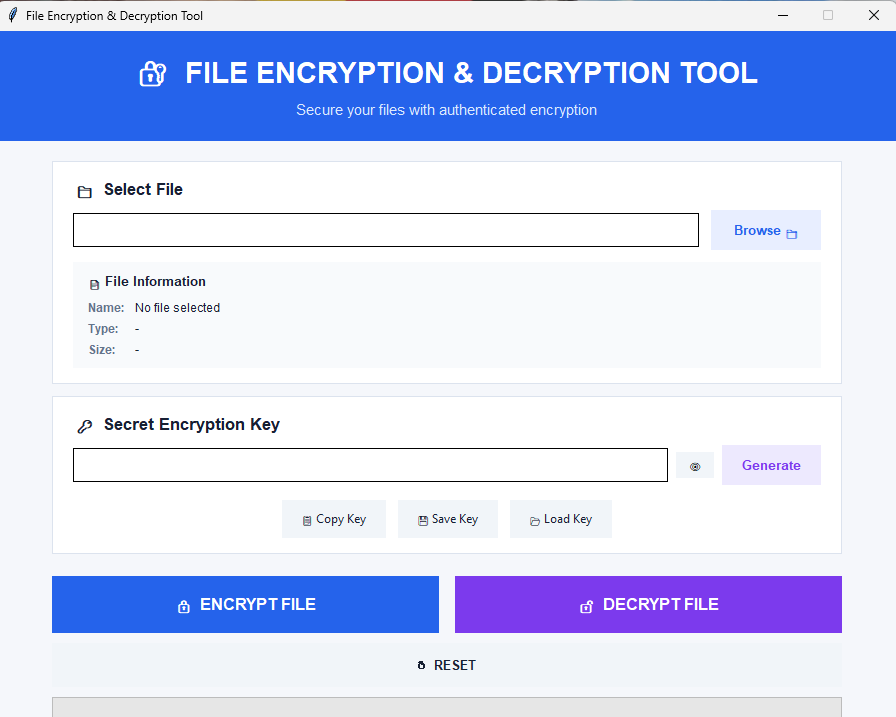

# File Encryption & Decryption Tool

A Python-based desktop application for securely encrypting and decrypting files using Fernet symmetric encryption, with SHA-256 integrity verification.

## Application Interface

<p align="center">
  
</p>

## Features

- Secure file encryption and decryption
- Fernet symmetric encryption
- Secure encryption key generation
- Save, load, copy, and show/hide encryption keys
- SHA-256 file integrity verification
- Detection of incorrect keys and modified encrypted files
- File selection and Save As functionality
- User-friendly Tkinter graphical interface
- Progress indicator and status messages

## Technologies Used

- Python
- Tkinter
- Cryptography (Fernet)
- SHA-256
- HMAC

## Installation

Install the required library:

```bash
pip install cryptography
```

## How to Run

Navigate to the project folder and execute:

```bash
python gui.py
```

## How to Use

1. Generate an encryption key or load an existing key.
2. Select the file you want to encrypt.
3. Click Encrypt and choose the output location.
4. To decrypt, select the encrypted file.
5. Load the same key used during encryption.
6. Click Decrypt.
7. Check the SHA-256 integrity verification result.

## Security

- Fernet provides authenticated symmetric encryption.
- SHA-256 is used to verify the integrity of the decrypted file against its embedded original hash.
- Modified encrypted files and incorrect keys are rejected.
- Keep encryption keys private and securely backed up.

**Important:** If the encryption key is lost, the encrypted files cannot be recovered. Store your key separately from encrypted files.

## Project Structure

```text
File-Encryption-Tool/
│
├── gui.py
├── README.md
├── requirements.txt
└── .gitignore
```

Keep personal keys and test files out of public GitHub repositories.

## Project Status

Completed – Core encryption, decryption, key management, and integrity verification tested successfully.
